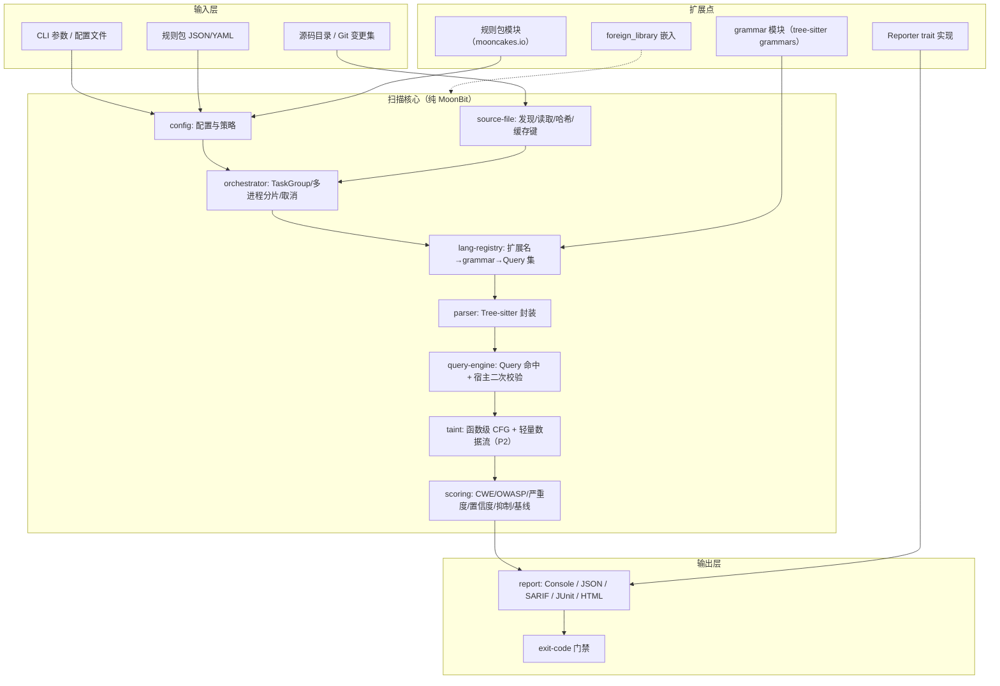

# 基于 MoonBit 的类 Kiuwan Code Security / SAST 工具：核心功能设计与实现规划

> **文档状态**：可执行设计草案（含可行性边界）——已按 P0 Spike 实测结果回填
> **信息核实日期**：2026-11-22
> **核实基准版本**：`moonc v0.10.19`（2026-11-05 发布）；**实测环境已更新到 `moonc v0.10.21`（2026-11-16）**、`moonbitlang/async` 0.22.10、`moonbit-community/treesitter` 0.1.1
> **标注约定**：`【已核实】`官方或包仓库可查；`【实测】`本机编译运行验证（见 `p0-spike/P0_SPIKE_实测报告.md`）；`【社区/实验】`存在但版本早期、采用度低；`【待确认】`信息不足，采用保守假设；`【不可行】`当前平台无可靠路径。
>
> **P1 落地入口**：本文档 §5.1 的 P1/MVP 已细化为可直接开工的规格，见 `P1_MVP_实施方案.md`（范围、版本锁定、实测 API 签名、包依赖、规则 DSL、CLI 契约、M0–M5 任务分解与验收命令）。两份文档冲突时以实施方案为准。

---

## 0. 前置：技术可行性边界与必要假设

本节是所有后续设计的地基。**结论先行：MoonBit 可以实现一个"CLI 优先、AST/Query 驱动、可嵌入、WASM 友好"的 SAST 扫描器；但不能在现阶段复刻 Kiuwan 的完整语言矩阵、深度语义分析与服务端合规平台。** 差距主要来自生态成熟度，而非语言本身表达力。

### 0.1 已核实的能力基线

| 类别 | 已核实事实 | 对 SAST 的意义 |
|---|---|---|
| 语言 | 静态强类型、类型推断、模式匹配与穷尽性检查、`enum`/`struct`/`trait`（显式 `impl`、0.10 起支持多态方法）、泛型、`raise`/`try`/`noraise` 受检错误、`defer`、`extenum` 跨包扩展枚举 | 适合表达 AST、IR、规则命中、Finding 等结构化领域模型；错误路径可被编译器强制处理 |
| 正则/词法 | 稳定 `re"..."` 正则字面量与 `=~`；`lexmatch`/`lexscan`（`lexscan` 于 0.10.9 稳定）；`moonbitlang/core/lexbuf` 提供 `StringScanner`/`Lexbuf`/`AsyncLexbuf`；0.10.19 新增字节正则 `reb"..."`（`lexscan` 暂不支持字节正则） | 规则中最常见的"字符串/注释/配置片段匹配"有一等公民支持，无需自建正则引擎 |
| 可选正则增强 | `moonbitlang/regexp` 为 alpha：支持捕获组、命名组、Unicode 属性、反向引用（官方明确警告反向引用可致指数复杂度），API 可能变 | 仅在需要 `\p{}`/反向引用时按需引入，不作为核心路径 |
| 解析 | `moonbit-community/treesitter@0.1.0`：纯 MoonBit 移植 Tree-sitter 0.28.0（parser generator、runtime、Query、highlight、tags、CLI），与固定上游版本做差分测试；runtime/query/generator/highlight/tags 支持 native/JS/WasmGC，CLI/loader/config 仅 native | **关键赋能项**：可用统一 AST + Query 做多语言结构化规则，避免为每个语言写解析器 |
| 语言包 | 上述项目的 `grammars/` 含 29 个语言模块；其中 bash/c/cpp/embedded-template/go/html/java/javascript/jsdoc/json/php/python/ruby/rust/typescript 为 fixture grammar（参与差分验证），另有 c-sharp/css/haskell/julia/ocaml/regex/scala/verilog/lua/make/markdown/toml/yaml/zig | P1 应只用 fixture grammar；其余标记实验性 |
| C 语义分析 | `Lampese/MCIL@0.1.1`【社区/实验】：C 前端（lexer→CABS→cabs2cil→CIL IR）+ CFG、支配、活跃性、use-def、简化、内联；支持 C89/C99/C11 及部分 GCC 扩展。下载量 56，约 10 个月未更新，依赖 async 0.15.0 | 可作为 C/C++ 深度分析的**参考设计与可选基线**，不作为 P0/P1 关键路径 |
| MoonBit 自身解析 | `moonbitlang/parser@0.4.7`【实验/不稳定】：MoonBit 源码 AST/LL(k) 容错解析 + moonyacc LR(1)、配置解析、formatter；`moonbitlang/moonlex`、`moonbitlang/moonyacc` 为生成器 | 若未来要做"MoonBit 代码自身的安全扫描"可直接复用 |
| IO/进程 | `moonbitlang/async`：结构化并发（TaskGroup 退出前等待所有任务）、隐式 await、`@fs` 读写/打开/`Watcher`/`realpath`、`@process.run`/`collect_output_merged`、`@http`、`@socket`、`@io.Reader/Writer`、`@async.Mutex`、`@async.platform` 运行时判定 OS | 文件发现、并发扫描、外部构建命令调用、watch 模式均有落点 |
| 并发语义 | 0.22 起取消信号改为编译器原语，不能被 `catch` 捕获，但可触发 `defer`/`errdefer`；任务默认可取消，`nocancel` 显式豁免；`@async.TaskGroup::add_defer` 回调须 `nocancel` | 可做"超时/用户中断即安全收尾"，但要按新语义设计清理逻辑 |
| 数据序列化 | `Json` 为一等类型，`derive(ToJson, FromJson)`、`@json.parse`/`@json.from_json`/`@json.inspect`、`Json::empty_object()`；`@json.inspect` 支持 flat/legacy 枚举风格 | SARIF 子集、规则配置、缓存、Finding 序列化零成本 |
| 工具链 | `moon check/build/run/test/fmt/bench/doc/coverage analyze/cram test/prove/ide *`；`moon.mod`/`moon.pkg`；`moon.mod` 的 `supported_targets`/`preferred_target`；`pkgtype(kind: "foreign_library")` 产出 `.a`/`.lib`；`#cfg` 按后端选依赖 | 测试、静态库嵌入、后端适配都有官方路径 |
| 形式化验证 | 0.9 起一等支持：`proof_ensure` 断言 + `moon.pkg` 开启 `options("proof-enabled": true)` + `moon prove`（SMT 后端） | 可用于验证**工具自身**的关键不变量（如指纹稳定性、区间不越界），不能用于证明被测代码无漏洞 |
| 部署 | native 新后端：macOS Apple Silicon 默认 debug；Linux x86-64 GNU；Windows x86_64-pc-windows-msvc（**实测 `v0.10.21` 下 debug/release 均可构建运行，自动定位 MSVC 工具链**）。默认 target 已改为 `wasm`，`--target native` 弃用，`moonx` 聚焦 Wasm | 本地 CLI 首选 native；Windows 实测无阻碍，回退路径降为可选 `【实测】` |
| Query 谓词 | **实测确认** `treesitter` 完整实现 `#eq?`/`#match?`/`#any-of?` 及 `not-` 变体，`QueryCursor` 在匹配阶段通过 `TextProvider` 执行判定；4 项谓词过滤测试全部通过 | 规则 DSL 可直接使用谓词，无需宿主降级 `【实测】` |
| 并发原语 | **实测确认** `moonbitlang/async@0.22.10` 提供 `Semaphore`（`acquire`/`release`/`try_acquire`）、`Mutex`、`cond_var`、`aqueue`；官方声明为单线程协作式多任务 | 并发度用 Semaphore，多核仍靠多进程分片 `【实测】` |
| 文件遍历 | **实测确认** `@fs.walk(path, callback, exclude?, max_concurrency?, allow_failure?)` 内置；回调 `(dir, entries)` 中 `entries` 含子目录名；另有 `readdir`/`opendir`/`kind`/`file_size` | 无需自建遍历器 `【实测】` |

### 0.2 必要假设（保守）

1. **A1 — 语言范围先窄后宽**：MVP 只覆盖 tree-sitter fixture grammar 中的 JavaScript/TypeScript、Python、Java，外加 JSON/YAML 配置类文件。C/C++ 走 MCIL 试验线，不进 MVP 验收。
2. **A2 — 规则以 AST Query 为主（已由实测收紧）**：规则表达 = tree-sitter Query + 谓词。**实测确认** `#eq?`/`#match?`/`#any-of?` 在 `treesitter@0.1.1` 中真实生效，可直接用于规则；复杂规则仍保留 `Node::utf8_text` + `re"..."` 的宿主二次校验作为通用能力。详见待确认项 T3/T11/T12。
3. **A3 — 污点分析为"轻量过程内"**：不做完整跨过程、跨文件、别名敏感的污点传播。MVP 只做"同一函数内 source → sink 的可达性 + 简单 sanitizer 阻断"。
4. **A4 — 并发≠多核并行（已由实测收紧）**：**实测确认** `moonbitlang/async` 为单线程协作式多任务、无用户态线程；Semaphore/Mutex/cond_var/aqueue 均可用。因此单进程内用 TaskGroup + Semaphore 做并发与限流，多核加速按"多 OS 进程分片 + 结果归并"设计。
5. **A5 — 指纹与缓存用现成库（已由 T4 实测收紧）**：`moonbitlang/core` 内置 `Hasher` 是 xxHash32（为 HashMap 设计，默认 seed 随机，**必须显式 `seed=0` 才稳定**），core **无 SHA-256**。改用 `mizchi/bit_hash@0.50.0` 做 SHA-256 内容指纹（NIST 向量校验通过、native/js/wasm-gc 三后端一致、Apache-2.0、仅依赖 `mizchi/simd`）；ignore 用 `mizchi/bit_ignore@0.50.0`（零依赖、Apache-2.0，支持否定规则、锚定、嵌套 base、truncate 回溯）。原"自实现 FNV-1a + 简化 glob"方案作废。注意 `String::to_bytes()` 非 UTF-8 且已弃用，哈希输入必须用 `@encoding/utf8.encode`。
6. **A6 — 参考能力集为行业通用集**："类 Kiuwan"按行业常见 SAST 能力（多语言、规则库、CWE/OWASP 映射、增量扫描、CI 集成、合规报告、仪表盘）理解；**未逐条核对 Kiuwan 官方产品清单**，见待确认项 T9。
7. **A7 — 版本锁定**：所有依赖与 `moonc` 版本在 `moon.mod`/CI 中固定。0.10.x 仍可能发生破坏性变更（如 0.10 的 `trait`/`impl` 需 `fn`、JS 后端 `Array` ABI 将变、`loop`/`try?` 弃用）。
8. **A8 — 不依赖未验证商业服务**：报告、规则分发先本地文件 + mooncakes.io 包； SaaS/多租户不在本期。

### 0.3 待确认项（发现即回填）

| ID | 待确认内容 | 保守假设 / 当前处理 | 影响 |
|---|---|---|---|
| T1 | MoonBit 1.0 实际发布时间与破坏性变更清单 | 实测数据点：`v0.10.21` 于 2026-11-16 发布，1.0 仍未到；按 0.10.x 锁定 | 高 |
| ~~T2~~ | ~~Windows native backend 可用性~~ | **✅ 已关闭（实测 Go）**：`--target native` debug/release 均可构建运行，自动定位 MSVC；回退路径降为可选 | 低 |
| ~~T3~~ | ~~Query 谓词支持度~~ | **✅ 功能已关闭（实测 Go）**：`#eq?`/`#match?`/`#any-of?` 实测生效；转为版本兼容风险 T11/T12 | 低 |
| ~~T4~~ | ~~SHA-256/xxhash 与 gitignore 库可用性~~ | **✅ 已关闭（实测 Go）**：core 仅 xxHash32（需 `seed=0`）；SHA-256 用 `mizchi/bit_hash@0.50.0`，ignore 用 `mizchi/bit_ignore@0.50.0`，8/8 测试三后端通过 | 低 |
| ~~T5~~ | ~~并发原语与线程模型~~ | **✅ 已关闭（实测 Go）**：Semaphore/Mutex/cond_var/aqueue 可用；单线程协作式；多核仍需多进程 | 低 |
| ~~T6~~ | ~~`@fs` 目录遍历 API~~ | **✅ 已关闭（实测 Go）**：`@fs.walk` 内置（带 exclude/max_concurrency），回调 entries 含子目录名 | 低 |
| T7 | `moonback`/`proton` 做服务端/桌面端的成熟度 | 不作为核心路径，列 P4 可选 | 低 |
| T8 | 规则/测试语料授权（Semgrep 规则、OWASP Benchmark、Juliet） | 仅用明确可再分发的语料；否则自建 fixture | 中 |
| T9 | Kiuwan 官方功能清单与本报告参考能力集的逐条差异 | 本规划按行业通用能力集，交付前由产品侧校准 | 中 |
| T10 | `moon prove` 对工具自身不变量（指纹稳定、区间合法）的实际可用性 | 列为 P4 增强，不进验收 | 低 |
| ~~T11~~ | ~~grammar 兼容补丁方案~~ | **✅ 已关闭（实测 Go）**：采用幂等脚本 `scripts/patch_grammars.py`（自动发现依赖、--check CI 门禁），不等待 upstream；`postadd` 与 `moon.work` 覆盖两方案已实测否决 | 低 |
| ~~T12~~ | ~~各 grammar 是否同类兼容问题~~ | **✅ 已关闭（实测）**：5/5 全中招（JS 0.25.0 / TS 0.23.2 / Python 0.23.6 / Java 0.23.5 / JSON 0.24.8），统一补丁后编译与加载测试全通过 | 低 |
| T13 | **（新增）** `moonbitlang/async@0.22.x` → `core/async` 迁移时间表 | 继续锁版本 + IO 层 trait 隔离 | 中 |

> P0 Spike 对 T2/T3/T5/T6 及 T11/T12 的完整实测过程、命令、输出与对设计的影响见 `p0-spike/P0_SPIKE_实测报告.md`；补丁脚本位于 `p0-spike/t11-t12-grammar/scripts/patch_grammars.py`。

### 0.4 可行性边界总表

- **可实现（本期）**：源码发现与读取、基于 Tree-sitter 的多语言 AST 解析、Query 规则匹配、JSON/YAML 规则包、配置化规则启用/禁用/严重度、CWE/OWASP 映射、严重度分级与置信度、抑制/基线、SARIF 子集 + JSON + Console 报告、CLI 退出码门禁、增量缓存、CI 集成、多进程分片并发、native/WASM 双目标。
- **条件可实现（后续阶段）**：轻量过程内污点分析、基于 CFG/支配/活跃性的数据流检查、C/C++ 借 MCIL 的深度分析、watch 模式、native 静态库嵌入、规则包发布到 mooncakes.io。
- **受平台限制暂不可实现**：全语言精确语义分析（无各语言 SSA/类型基础设施）、跨过程/别名/指针敏感分析、符号执行与漏洞证明、JVM/.NET 字节码与二进制扫描、主流 IDE 插件（无已核实的 MoonBit IDE 扩展 API）、成熟 SaaS 多租户后端与合规认证报告、Kiuwan 全量语言与专有规则库。

---

## 1. 目标范围与能力拆解

### 1.1 产品定位

一个 **CLI 优先、可嵌入、规则可配置、输出标准化** 的源代码安全分析引擎。第一目标是"在 CI 中稳定发现常见注入类与危险 API 误用"，第二目标是"作为库被其他 MoonBit 工具链/IDE 复用"，**不是**在第一天对标商业平台的全量能力。

### 1.2 能力矩阵与优先级

| 能力域 | 具体能力 | 优先级 | 实现路径 | 主要依据/风险 |
|---|---|---|---|---|
| 源代码扫描 | 目录递归发现、扩展名→语言映射、二进制/超大文件跳过、编码归一化（UTF-8） | 必须 | `moonbitlang/async` `@fs` + 自实现遍历；`【已核实】`IO，T6 待确认 | 文件遍历 API 形态待验证 |
| 源代码扫描 | 多语言 AST 解析（JS/TS、Python、Java、JSON） | 必须 | Tree-sitter 纯 MoonBit 移植 + fixture grammar | 0.1.0 实验性，锁版本 |
| 源代码扫描 | 解析错误容错（错误节点记录但不中断） | 必须 | Tree-sitter `Tree` 错误节点 + 扫描告警 | 已核实 parser 有错误恢复 |
| 规则/漏洞检测 | AST Query 模式匹配（危险调用、硬编码密钥、危险配置） | 必须 | `Query`/`QueryCursor` + 捕获节点 | 谓词支持 T3 待确认 |
| 规则/漏洞检测 | 宿主侧二次校验谓词（文本相等、上下文、参数位置） | 必须 | `Node::kind`/源文本切片 + `re"..."` | 已核实 |
| 规则/漏洞检测 | 过程内轻量污点（source→sanitizer→sink） | 必须（P2） | 自建函数级 CFG + 前向数据流 | 无现成污点引擎，需自建 |
| 规则/漏洞检测 | 基于 CFG 的未初始化/活跃性类检查 | 可选 | 借鉴 MCIL 的 dataflow/dominator/liveness 设计 | 社区库低采用度，先借鉴后自研 |
| 规则配置与管理 | JSON/YAML 规则包、按 ID/language/severity 启用禁用、规则校验器 | 必须 | `@json` + `FromJson` derive + `rules-validate` CLI | 已核实 JSON 一等支持 |
| 规则配置与管理 | 规则包版本、签名、mooncakes.io 分发 | 可选（P3） | mooncakes.io 模块 + `moon add` | 仓库支持 `moon deprecate`/search |
| 扫描结果报告 | Console 摘要、JSON 全量、SARIF 子集、JUnit（CI 门禁） | 必须 | `derive(ToJson)` + 自定义 writer | 已核实 |
| 扫描结果报告 | HTML 交互报告 | 可选（P3） | 静态 HTML + 内嵌 JSON | 无已核实模板引擎，手写即可 |
| 缺陷分类分级 | CWE/OWASP 映射、Critical/High/Medium/Low/Info、置信度 | 必须 | 规则元数据 + `scoring` 模块 | 已核实 enum/struct 表达 |
| 缺陷分类分级 | 抑制（行内注释/文件）、基线（baseline JSON）、指纹去重 | 必须 | SHA-256（`bit_hash`）+ 归一化片段指纹 | T4 已实测可用 |
| 构建/版本控制集成 | CLI 退出码策略、JUnit 输出、GitHub Action 包装、pre-commit 脚本 | 必须 | `apps/scan` + `@process` + 现有 setup-moonbit Action | 已核实 CLI/进程 API |
| 构建/版本控制集成 | PR 增量扫描（只扫 diff）、变更集驱动 | 可选（P3） | `git diff` 经 `@process` + 缓存 | 依赖 git CLI |
| 构建/版本控制集成 | watch 模式（保存即扫） | 可选（P4） | `@fs.Watcher::wait()` | Wasm1 暂不支持 Watcher |
| 部署运行 | native CLI（Linux/macOS/Windows） | 必须 | `--target native`，Windows 回退 C backend/WASM | T2 关键风险 |
| 部署运行 | WASM + `moonrun` 跨平台运行 | 可选（P3） | 默认 wasm target；async 需最新 moonrun | 已核实 |
| 部署运行 | 静态库嵌入宿主程序 | 可选（P4） | `pkgtype(kind: "foreign_library")` → `.a`/`.lib` | 已核实 |
| 扩展机制 | 新语言 = grammar 模块 + 规则包，零核心改动 | 必须 | Tree-sitter grammar modules 设计 | 已核实 |
| 扩展机制 | 自定义报告器、自定义规则谓词模块 | 可选 | `trait Reporter` + 规则模块 | trait/impl 已核实 |
| 服务端/仪表盘 | 多租户、权限、审计、Web 控制台 | 暂不可实现（本期） | `moonback` 仅 P4 调研 | T7 待确认 |

### 1.3 MVP 明确非目标

不做：跨过程污点、别名/指针分析、符号执行、SSA 中间表示、JVM/.NET 字节码、容器镜像、IDE 插件、SaaS 服务端、合规认证报告、Kiuwan 专有规则移植（授权未明）。

---

## 2. 能力评估：MoonBit 对各环节的支撑度

> 评级：**强** = 一等支持且有稳定 API；**中** = 可用但需自建关键部分或版本早期；**弱** = 有理论路径但缺验证；**无** = 无可靠路径。

### 2.1 解析（强，带成熟度风险）

- **支持度**：Tree-sitter 纯 MoonBit 移植提供 `Parser`/`Tree`/`Node`/`TreeCursor`/`Query`/`QueryCursor`/`LookaheadIterator`，API 名称与语义对齐上游；语言以可移植表 `@language.Language` 表示，无需 C runtime/Rust 生成器/动态库；运行、Query、生成、highlight、tags 支持 native/JS/WasmGC。
- **限制**：版本 0.1.0，明确为实验性；CLI/loader/config 仅 native；`build` 不能产出共享库/`--wasm` 被拒（改为生成 MoonBit 模块）；非 fixture grammar 未参与差分验证；外部 scanner 需使用移植版或 `scanner.mbtx`。
- **风险**：grammar 升级可能使 Query 失效（上游用 `LanguageMetadata` 语义版本提示兼容性）；0.1.0 API 可能变动。
- **替代方案**：`tonyfettes/tree_sitter` C FFI 绑定（native only、早期、Windows 未测试）【社区/实验】；纯正则文本扫描（高误报，仅应急）；`moonbitlang/parser`（仅当被测语言是 MoonBit 自身）。

### 2.2 规则表达（强）

- **支持度**：`re"..."` + `=~` 稳定；`lexmatch`/`lexscan` + `lexbuf`；`moonbitlang/regexp` 提供 Unicode 属性、命名捕获、反向引用（alpha）；规则配置可用 `Json` + `derive(FromJson)` 强类型反序列化；规则逻辑可用 MoonBit 函数表达，且 `extenum` 允许跨包扩展事件/命中类型。
- **限制**：`moonbitlang/regexp` 反向引用有指数复杂度风险，不宜用于不可信规则；Tree-sitter Query 谓词支持度 T3 待确认；JSON 枚举格式在 0.8 后限 `flat`/`legacy` 两风格，自定义格式需手写 trait。
- **风险**：规则作者同时要懂 Query 与 MoonBit 二次校验，学习成本高于纯 YAML 方案（Semgrep）。
- **替代方案**：规则 DSL 降级为"JSON 描述 + 固定谓词集合"，不暴露任意 MoonBit 代码；复杂规则通过独立规则模块发布。

### 2.3 文件与 IO（强）

- **支持度**：`@fs.read_text_file`/`write_text_file`/`open`、`@fs.Watcher`、`@fs.realpath`、`@io.Reader`/`Writer`、`@process.run`/`collect_output_merged`、`@async.platform`；结构化并发 + `defer`/`errdefer` 保障资源释放；可选 FD 泄漏检查 `MOONBIT_ASYNC_CHECK_FD_LEAK=1`。
- **限制**：核心路径依赖 `moonbitlang/async`；官方声明未来 `moonbitlang/core/async` 成为默认、旧库逐步弃用，当前 core/async 仍实验且 API 演进中；Wasm1 下 `@fs.Watcher` 不支持（其余已补齐）；Windows 上部分 IO 语义（符号链接、append 模式随机写）有特殊行为。
- **风险**：运行时迁移导致 IO 层重写。
- **替代方案**：把 IO 全部收敛到一个 `source-file` 包，界面用 `trait SourceReader` 抽象；迁移时只换实现。

### 2.4 并发（中）

- **支持度**：async 隐式 await、TaskGroup 结构化并发（组退出前等待所有子任务）、`@async.Mutex`、取消信号 + `defer`/`errdefer`、`async test` 并行。
- **限制**：未核实线程/共享内存并行与 semaphore/channel（T5）；取消在 0.22 改为不可捕获的编译器原语，旧 `is_cancellation_error` 逻辑失效。
- **风险**：CPU 密集的 AST 解析在单进程内可能只有异步并发而无多核加速；取消处理写错会导致资源泄漏或结果丢失。
- **替代方案**（实测后更新）：单进程内用 TaskGroup + **`Semaphore`（已实测可用）** 限制并发度；多核加速用多 OS 进程分片（`apps/scan --shard i/n`）+ 结果归并；取消只做"停止派发新文件 + 等待在途任务收尾"，permit 用 `defer release()` 归还。

### 2.5 部署与运行（中，Windows 是关键约束）

- **支持度**：native（macOS Apple Silicon 默认 debug、Linux x86-64 GNU、Windows MSVC nightly）；release 用 C backend `-O2`；默认 target 为 wasm，`moonx` 聚焦 Wasm；WASM 程序跨平台，`moonrun` 可运行；`pkgtype(kind: "foreign_library")` 产出 `.a`/`.lib`。
- **限制**：Windows native 仍 nightly 且需手动装 MSVC Build Tools（moon 可自动定位 `cl.exe`/`clang-cl.exe`）；使用 `moonbitlang/async` 的 WASM 必须用最新 `moonrun`，与其他 Wasm runtime 不兼容；JS 后端 `Array` ABI/布局将破坏性变更，FFI 边界应改用 `FixedArray`。
- **风险**：目标环境无法跑 native → CI 失败；WASM 下功能子集缩水。
- **替代方案**：三档部署策略——native 首选 → Windows fallback C backend → WASM + moonrun（明确降级功能清单）。

### 2.6 构建集成（强）

- **支持度**：`moon build/check/test/fmt/bench/doc/coverage analyze/cram test/prove` 齐备；`moon.mod`/`moon.pkg` 可声明 `supported_targets`/`preferred_target` 与 `options`；`#cfg` 可按后端选择依赖与代码；`moon cram test` 专为 CLI 应用做端到端测试；社区已有 `hustcer/setup-moonbit` GitHub Action。
- **限制**：`--target native` 已弃用（默认 wasm），CI 脚本需按新参数写；`moon cram test` 仍实验性、依赖 native 构建。
- **风险**：工具链升级导致 CI 参数失效。
- **替代方案**：CI 固定 moonc 版本 + 容器化；cram 测试之外保留一层纯 shell/Python 冒烟测试。

### 2.7 扩展机制（中→强）

- **支持度**：新语言 = 新增 grammar 模块 + 规则包（Tree-sitter 设计天然支持）；`extenum` + `+=` 支持跨包扩展枚举构造器；`trait`/`impl` 支持自定义 Reporter/Rule 接口；`#cfg` 支持后端特定实现；mooncakes.io 可分发规则包与工具；`foreign_library` 可嵌入宿主。
- **限制**：`extenum` 匹配必须带 wildcard（非穷尽）；规则包版本治理、签名机制需自建；社区包版本早期。
- **风险**：扩展点过多导致接口不稳定。
- **替代方案**：P1 只开放两个扩展点（语言包、规则包），其余内部化；接口稳定后再开放。

---

## 3. 架构设计

### 3.1 总体架构



### 3.2 关键模块职责

| 模块（包名） | 职责 | 不负责 |
|---|---|---|
| `config` | 解析 CLI/配置文件，产出不可变 `ScanConfig`；规则启用策略、严重度门禁、输出格式 | 规则语义 |
| `source-file` | 目录遍历、ignore、扩展名识别、读取为 UTF-8、内容哈希、行偏移表 | 语言语法 |
| `lang-registry` | 语言 ID ↔ grammar 构造 ↔ 默认 Query 集 ↔ 文件后缀 | 规则内容 |
| `parser` | 封装 Tree-sitter：`parse(bytes) -> Tree?`，暴露节点遍历、节点文本、错误节点集合 | 安全判断 |
| `query-engine` | 编译规则 Query、执行匹配、捕获组提取、宿主谓词二次校验 → `RawHit` | 分级 |
| `taint`（P2） | 函数级 CFG 构建、source/sanitizer/sink 标注、前向可达性 → 确认/裁剪 `RawHit` | 跨过程分析 |
| `scoring` | 严重度/置信度计算、CWE/OWASP 映射、指纹生成、抑制与基线比对 → `Finding` | 报告渲染 |
| `cache` | 以 (路径, 内容哈希, 规则包版本) 为键缓存函数级结果；增量复用 | 规则判定 |
| `report` | 实现 `Reporter` trait，输出 Console/JSON/SARIF/JUnit/HTML | 扫描调度 |
| `orchestrator` | 任务分片、TaskGroup + Semaphore 并发限流、超时/取消、进度事件、结果归并排序 | 具体检测逻辑 |
| `apps/scan` | CLI 入口、退出码策略、shard 参数 | 业务逻辑 |
| `apps/rules-validate` | 规则 schema 校验 + Query 编译校验（利用 `QueryError` 携带行列偏移） | 扫描 |

### 3.3 数据流（单次扫描）

1. `apps/scan` 读取 `ScanConfig`（路径、语言集、规则包版本、输出格式、门禁阈值、shard 编号）。
2. `source-file` 递归枚举文件 → 过滤 ignore/二进制/超限 → 读取 UTF-8 文本 → 计算内容哈希与行偏移表。
3. `lang-registry` 按扩展名解析语言；未识别语言进 `skipped` 统计。
4. `cache` 查键：`(path, content_hash, rulepack_version, analyzer_version)`；命中则直接取旧 `Finding` 列表。
5. 未命中：`parser` 用对应 grammar 解析为 `Tree`；错误节点记录为 `ParseWarning`，继续分析其余部分。
6. `query-engine` 对每条启用规则执行 Query → 捕获节点 → 二次校验谓词（文本相等、参数位置、上下文）→ `RawHit`。
7. （P2）`taint` 对命中所在函数构建 CFG，做 source→sink 可达性与 sanitizer 阻断，给 `RawHit` 标注 `taint_confirmed: Bool`。
8. `scoring` 合并规则元数据（severity/CWE/OWASP）与置信度 → 指纹去重 → 应用抑制与基线 → `Finding[]`。
9. `report` 按配置渲染；`orchestrator` 归并各 shard 结果并**全量排序**保证确定性。
10. 退出码：按门禁策略（如存在 High 及以上 → 非 0）；JUnit 供 CI 展示。

### 3.4 核心接口设计（示意，命名按实际版本校准）

```moonbit
// core-model
enum Severity { Critical | High | Medium | Low | Info }
enum Confidence { High | Medium | Low }

struct SourceLoc {
  path : String
  line : Int
  column : Int
  byte_offset : Int
} derive(Show, ToJson, @json.FromJson, Eq)

struct Finding {
  rule_id : String
  severity : Severity
  confidence : Confidence
  cwe : Array[Int]
  owasp : Array[String]
  primary : SourceLoc
  related : Array[SourceLoc]
  message : String
  fingerprint : String
} derive(Show, ToJson, @json.FromJson)

// query-engine
struct RawHit {
  rule_id : String
  primary : SourceLoc
  captures : @map.HashMap[String, String]  // 捕获名 -> 源文本
  taint_confirmed : Bool
}

// rule
struct Rule {
  id : String
  language : String
  severity : Severity
  cwe : Array[Int]
  owasp : Array[String]
  query : String
  predicates : Array[PredicateSpec]  // 固定谓词集合，避免任意代码执行
  message : String
  enabled : Bool
} derive(@json.FromJson, ToJson)

// report —— 扩展点
trait Reporter {
  fn render(self, result : ScanResult) -> String
  fn extension(self) -> String
}

// orchestrator
struct ScanConfig {
  roots : Array[String]
  languages : Array[String]
  rulepacks : Array[String]
  formats : Array[String]
  fail_on : Severity
  shard_index : Int
  shard_total : Int
  incremental : Bool
}
```

**规则文件示例**（JSON，由 `apps/rules-validate` 在加载时校验并编译 Query）：

```json
{
  "id": "JS-SQLI-001",
  "language": "javascript",
  "severity": "high",
  "cwe": [89],
  "owasp": ["A03:2021"],
  "query": "(call_expression function: (identifier) @fn arguments: (_) @arg) @call",
  "predicates": [
    { "kind": "text_equals", "capture": "fn", "value": "query" },
    { "kind": "not_has_prefix", "capture": "arg", "value": "\"\"" }
  ],
  "message": "Potential SQL injection via unsanitized query argument"
}
```

> 注：`predicates` 故意限定为**固定谓词集合**，不执行任意 MoonBit 代码，便于审计与跨平台一致。需要复杂逻辑时以独立规则模块发布并显式登记。

### 3.5 模块依赖与工程结构

```
sast-mbt/
  moon.work                  # workspace：所有包统一 check/test
  moon.mod                   # 锁定 moonc 版本与依赖版本
  libs/
    core-model/              # 无依赖（仅 core）
    config/                  # -> core-model
    source-file/             # -> core-model, async
    lang-registry/           # -> core-model, treesitter + grammar 模块
    parser/                  # -> core-model, lang-registry, treesitter
    query-engine/            # -> parser, rule
    rule/                    # -> core-model
    taint/                   # -> parser, core-model（P2）
    scoring/                 # -> core-model, cache
    cache/                   # -> core-model, source-file
    report/                  # -> core-model
    orchestrator/            # -> 上述全部（顶层编排）
  apps/
    scan/                    # -> orchestrator, config, report
    rules-validate/          # -> rule, lang-registry, treesitter
  rulepacks/official/        # JSON 规则 + 规则包清单
  tests/fixtures/            # 含已知漏洞/干净对照的样例仓库
```

依赖方向严格单向：`core-model` 最底层，`orchestrator` 最顶层；`report` 不反向依赖 `orchestrator`。`#cfg` 用于把 native 的 `@fs`/`@process` 实现与 WASM 的受限实现放在同一别名下。

### 3.6 扩展点清单

| 扩展点 | 扩展方式 | 稳定性承诺 |
|---|---|---|
| 新语言 | 新增 tree-sitter grammar 模块 + 语言注册项 + Query 规则包 | P1 起开放 |
| 新规则 | 在规则包增加 JSON 规则，经 `rules-validate` 校验 | P1 起开放 |
| 自定义校验谓词 | 实现约定 trait 的规则模块，显式列入规则包依赖 | P2 开放 |
| 新报告格式 | `impl Reporter for X` | P2 开放 |
| 污点规则集 | source/sanitizer/sink 清单为数据，不编译进核心 | P2 开放 |
| 后端适配 | `#cfg(target=...)` 提供不同 IO/grammar 实现 | 内部使用 |
| 嵌入集成 | `pkgtype(kind: "foreign_library")` 输出 `.a`/`.lib` | P4 开放 |

---

## 4. 使用与对比

### 4.1 典型应用场景

1. **本地提交前自检**：开发者运行单目录扫描，Console 输出高亮问题，非 0 退出码阻断提交。
2. **CI 质量门禁**：PR 流水线运行 `--format junit --fail-on high`，失败则阻断合并；JUnit 在 CI UI 展示。
3. **增量扫描**：`--incremental` 基于内容哈希与规则包版本复用缓存，只重扫变更文件；配合 `git diff` 做 PR 增量。
4. **规则治理**：安全团队维护独立规则包模块，发布到 mooncakes.io；业务线通过版本号固定规则集。
5. **嵌入工具链**：以静态库形式嵌入内部开发者工具或轻量服务端（P4）。

### 4.2 实际使用特征

```bash
# 基础扫描
moon run apps/scan -- scan --root ./src --language javascript,typescript \
  --rulepack ./rulepacks/official --format console --fail-on high

# CI 门禁 + 增量 + 多进程分片
moon run apps/scan -- scan --root . --incremental \
  --format json --format junit --out ./reports --shard 1/4
moon run apps/scan -- merge --in ./reports --out ./sarif

# 规则校验
moon run apps/rules-validate -- check ./rulepacks/official
```

特征：无服务端依赖；输出确定性可 diff；规则是数据而非代码；错误节点与解析失败不会中断整仓扫描；Windows/macOS/Linux 行为通过 CI 矩阵保证一致。

### 4.3 优点与缺点

**优点**

- 强类型 + 模式匹配 + 受检错误让 AST/IR/Finding 领域模型表达清晰，规则引擎自身的 bug 更少。
- Tree-sitter 纯 MoonBit 移植带来统一 AST 与 Query，多语言扩展成本低，且可编译到 WasmGC/native，部署形态灵活。
- 标准库一等 JSON 与 `derive` 让规则、配置、SARIF 序列化几乎零胶水代码。
- 结构化并发 + 取消 + `defer` 使超时与资源收尾可控；`cram test`/`coverage analyze`/`bench`/`prove` 提供完整工程化闭环。
- 产物小、启动快（相对 JVM 系工具），适合 CLI 与边缘/CI 环境。

**缺点**

- 生态早期：Tree-sitter 移植 0.1.0、MCIL 社区库采用度低、async 运行时面临迁移、1.0 未发布，版本锁定与升级成本真实存在。
- 分析深度不足：无各语言 SSA/类型基础设施，缺少跨过程与别名分析，复杂漏洞（如跨文件污点）暂不可及。
- 规则覆盖从零起步：相比 Semgrep/SonarQube 多年积累的规则库，初期规则数量与成熟度差距大。
- Windows native backend 仍在 nightly，需要回退方案与额外 CI 验证。
- 规则作者需理解 Query + 宿主谓词，学习曲线高于纯 YAML 正则方案。
- 无 IDE 插件与 Web 控制台，开发者体验弱于商业产品。

### 4.4 与相关方案客观对比

| 方案 | 分析机制 | 规则表达 | 深度分析 | 语言/生态 | 部署形态 | 与本项目关系 |
|---|---|---|---|---|---|---|
| **本项目（MoonBit SAST）** | Tree-sitter AST + Query + 轻量 CFG | JSON 规则 + 固定谓词 | 过程内（P2），无 SSA | 初期 3–4 语言，逐步扩展 | CLI / WASM / 静态库 | — |
| **Semgrep** | AST 模式匹配 | YAML 规则，生态成熟 | 有限跨语句，商业版加强 | 30+ 语言，规则库丰富 | CLI / SaaS | **最接近的对标**；本项目规则 DSL 思路相似，但用 MoonBit 实现且可嵌入；规则数量远少于 Semgrep |
| **CodeQL** | 代码数据库 + Datalog 查询 | QL 语言 | 强：数据流/污点/跨过程 | 主流语言，GitHub 生态 | CLI / SaaS | 深度显著强于本项目；本项目不具备 QL 级别的查询抽象与数据库 |
| **SonarQube** | 多语言分析器 + 规则 | Java/插件规则 | 中–强，服务端聚合 | 非常成熟 | 服务端 + IDE 插件 | 本项目 CLI 优先、无服务端/仪表盘；可作为其流水线中的轻量前置门禁 |
| **Kiuwan 类商业 SAST** | 多引擎 + 专有规则 | 平台规则库 | 强，含合规报告 | 30+ 语言，企业特性 | SaaS / On-prem | 本规划只覆盖其子集；语言矩阵、合规认证、IDE 集成明确不入本期 |
| **自研正则/文本扫描** | 正则匹配源码文本 | 正则 | 几乎无 | 任意语言 | 极简 | 本项目以 AST 降低误报，代价是需要 grammar 与版本治理 |

**客观结论**：本项目当前的优势不是"检测能力更强"，而是"实现统一、类型安全、可嵌入、跨平台产物小、工程化工具链完整"。若目标是立刻获得大规模语言覆盖与深度漏洞发现，应选用成熟方案；若目标是构建可控、可定制、可运行在受限环境的国产化/内置式分析引擎，MoonBit 路线合理但需接受较长的规则与分析能力建设周期。

---

## 5. 落地计划

### 5.1 分阶段实施

#### P0 — 可行性验证（Spike，不写产品代码）

**目标**：把 0.3 中高风险待确认项变成事实。

步骤：
1. 在目标三平台（Linux、macOS、Windows）安装并锁定 `moonc v0.10.19`，跑通 `moon new/check/build/test/fmt/coverage analyze`。
2. 建立最小 workspace，引入 `moonbit-community/treesitter@0.1.0` 与 `tree-sitter-json`、`tree-sitter-javascript`、`tree-sitter-python`、`tree-sitter-java`，native 构建并执行官方示例中的 `Query::new` + `QueryCursor::matches`。
3. 验证 Query 谓词可用性（T3）；不可用则验证 `Node` 源文本切片与 `re"..."` 的二次校验路径。
4. 验证 `@fs` 目录遍历、`@fs.read_file`、`@process.run`、`@async.Mutex`、TaskGroup 取消与 `defer` 语义（T5/T6）。
5. 验证 `derive(ToJson, FromJson)` 生成 SARIF 子集 JSON；验证 `moon cram test` 对 CLI 端到端可用。
6. 在 Windows 上分别验证 native（nightly）与 C backend 回退；记录差异。
7. 输出 P0 报告：确认/推翻每条假设，更新本文档的待确认项。

**退出标准**：能在至少 Linux 与 Windows 上，从一个真实 JS 文件解析出 AST、执行一条 Query、产出一条 JSON Finding；所有高度风险待确认项有明确结论。

#### P1 — MVP：AST/Query 扫描器可用

步骤：
1. 落地 `core-model`、`config`、`source-file`、`lang-registry`、`parser`、`query-engine`、`rule`、`scoring`、`report`、`orchestrator`、`apps/scan`、`apps/rules-validate`。
2. 官方规则包首批覆盖 JS/TS、Python、Java、JSON 配置：注入类危险 API、硬编码凭据、不安全配置、危险反序列化等，每语言 ≥ 20 条。
3. 实现 Console/JSON/JUnit 报告、退出码门禁、抑制与 SHA-256 指纹去重（`bit_hash`，输入用 `@utf8.encode`）。
4. 实现 TaskGroup + Semaphore 并发限流与 `--shard i/n` 多进程分片（结果全量排序）；`source-file` 基于 `@fs.walk` 实现文件发现（注意回调 `entries` 含子目录名）。
5. 建立 `tests/fixtures`：每类规则至少 1 个正例 + 1 个反例；`moon cram test` 覆盖 CLI 行为。
6. GitHub Actions 矩阵（M0 落地为 Linux/Windows 两平台，macOS 后补）跑 `scripts/verify.sh`（依赖解析 → 补丁 → 门禁 → `moon check` → `moon test --target js` → `moon fmt --check`）+ full-SDK runner 上的 `moon test --target native`；P2 起加 `moon coverage analyze` 与 `moon cram test tests/cram/`（**cram 必须显式传测试目录**：实测无参数时发现 0 个用例且仍返回 0）。工具链由 `moonbit-version` 文件 + `chawyehsu/setup-moonup@v2` 双重锁定为 `0.10.21+06da1ed44`。

**验收指标（目标值，P0 后按基线校准）**

| 指标 | 目标 |
|---|---|
| 规则fixture检出率 | 已声明规则类别 ≥ 90% |
| 干净对照误报率 | ≤ 10%（按 Finding/文件计） |
| 确定性 | 同输入同版本 → JSON 报告逐字节一致 |
| 容错 | 注入语法错误文件后扫描仍完成，且产生 ParseWarning |
| 平台 | Linux/macOS 通过；Windows 至少一条回退路径通过 |
| 性能 | 记录 native 基线（LOC/s、峰值内存）；P2 起设回归阈值 |

#### P2 — 分析深度：轻量污点与数据流

步骤：
1. `taint` 模块：函数级基本块/CFG 构建（参考官方静态分析文章的三地址码 + worklist 不动点框架），支配/活跃性作为辅助。
2. source/sanitizer/sink 数据驱动配置；对 `RawHit` 做过程内可达性确认，输出置信度。
3. `cache` 增量：以内容哈希 + 规则包版本 + 分析器版本为键缓存函数级结果。
4. SARIF 子集与基线（baseline JSON）；PR 增量扫描。
5. C/C++ 线：对 MCIL 做适配 spike（构建、C99 样例解析、CFG 导出），**通过才纳入**，否则仅保留参考实现。

**验收**：在自建/OWASP Benchmark 子集上，注入类规则的误报率相对 P1 下降；增量扫描耗时低于全量；MCIL spike 有明确 go/no-go 结论。

#### P3 — 工程化与生态

步骤：规则包发布到 mooncakes.io 并版本化；规则 lint 增强；HTML 报告；GitHub Action 封装；WASM + `moonrun` 目标验证（明确功能降级清单）；扩展规则谓词与 Reporter trait 稳定化；语言扩展到 C#/Go/Rust/PHP（先 fixture grammar）。

#### P4 — 可选增强

静态库嵌入（`foreign_library`）；watch 模式；`moon prove` 验证工具自身关键不变量；`moonback`/`proton` 服务端/桌面端调研；MoonBit 自身代码扫描（`moonbitlang/parser`）。

### 5.2 验收指标汇总

- **功能**：P1/P2 各阶段退出标准见上；每阶段必须可演示、可复现。
- **质量**：规则检出率、误报率、确定性、容错、跨平台一致性。
- **性能**：阶段基线 + 回归阈值（P0 建立基线，避免虚构数字）。
- **安全**：规则执行沙箱化（固定谓词集合，禁止任意代码）；供应链锁定依赖版本；规则包可审计。
- **可维护**：模块依赖单向；`moon check` 零错误；测试覆盖率持续增长；所有待确认项在对应阶段关闭或重新评估。

### 5.3 测试策略

| 层级 | 手段 | 覆盖对象 |
|---|---|---|
| 单元 | MoonBit 内联 `test` 块，`moon test` | 指纹、行偏移、评分、JSON roundtrip、CFG 构建 |
| 规则校验 | `apps/rules-validate` + `QueryError` 行列信息 | 规则 schema、Query 可编译性、谓词白名单 |
| CLI 端到端 | `moon cram test <目录>`（**实测必须显式传路径**；Markdown `mooncram` 代码块，每块独立 shell 表达式）；测试内用 `printf` 自建 fixture，`main.exe` 由工具自动加入 PATH | 参数、输出、退出码、shard 归并 |
| Golden/回归 | fixture 仓库 + 期望 Finding 快照 | 规则误报/漏报回归 |
| 差分 | 借助 Tree-sitter 自带 differential oracle；规则结果与人工标注对照 | grammar 升级、Query 语义变化 |
| 属性测试 | `moonbitlang/quickcheck`【社区】 | 规则 ID 唯一、指纹稳定、区间不越界 |
| 性能 | `moon bench`、`moon test --profile`/`moon run --profile`（xctrace/perf） | 解析与 Query 热点 |
| 覆盖 | `moon coverage analyze` | 未测分支 |
| 跨平台 | CI 矩阵 + Windows 回退路径 | native/C backend/WASM 差异 |

### 5.4 风险清单

| ID | 风险 | 等级 | 缓解措施 |
|---|---|---|---|
| R1 | Tree-sitter 移植仍实验性、API/行为变更 | 中 | 锁 `treesitter@0.1.1+`；P1 只用 fixture grammar；差分与 golden 测试；封装在 `parser` 包内 |
| R2 | 1.0 未发布、语法/ABI 破坏性变更（JS Array ABI 等） | 高 | 锁 `moonc`（实测 0.10.21）；升级独立迁移；FFI 边界用 `FixedArray`；CI 固定版本 |
| R3 | ~~Windows native backend 仅 nightly~~ **已实测解除** | 低 | debug/release 均构建运行成功；保留 CI 矩阵验证，回退路径降为可选 |
| R4 | `moonbitlang/async` → `core/async` 迁移（T13） | 中 | IO 收敛到 `source-file`，以 trait 隔离；锁 async 版本（实测 0.22.10） |
| R5 | ~~Query 谓词不可用~~ **已实测解除**；grammar 包版本兼容（T11/T12）**已实测有解** | 低 | 谓词实测可用；锁定 `treesitter@0.1.1+` 与 grammar 版本；`moon add` / CI checkout 后、构建前执行 `scripts/patch_grammars.py`，`--check` 作为 CI 前置门禁；upstream 生成脚本修复后脚本自动跳过 |
| R6 | 无用户态多核并行（实测确认单线程协作式） | 中 | 多进程分片 + 归并；单进程限流用已实测的 Semaphore（非 Mutex 计数器） |
| R7 | 规则覆盖不足、误报高 | 高 | 从小而精规则集起步；每规则正反例；置信度、抑制、基线；不盲目扩语言 |
| R8 | 深度分析能力缺失 | 中 | 明确过程内边界；C 线用 MCIL 做 go/no-go spike；不承诺跨过程 |
| R9 | 语料与规则授权（T8） | 中 | 只用可再分发语料；自建 fixture 兜底；法务确认后再引入外部规则 |
| R10 | 社区库采用度低（MCIL、quickcheck 等） | 中 | 不作为 P0/P1 关键路径；必要时 fork 并自带测试 |
| R11 | 供应链与规则包安全 | 中 | 版本锁定、规则包可审计、禁止规则执行任意代码、校验器前置 |

### 5.5 未覆盖功能说明（本期明确交付边界之外）

- 不提供 SaaS 服务端、多租户、用户权限、审计日志与 Web 仪表盘（T7 仅调研）。
- 不提供 VS Code/JetBrains 等主流 IDE 插件（无已核实的 MoonBit IDE 扩展 API）。
- 不支持 JVM/.NET 字节码、二进制文件、容器镜像、依赖供应链（SCA）扫描。
- 不实现跨过程/跨文件污点、别名与指针分析、符号执行、SMT 漏洞证明。
- 不提供 PCI-DSS/SOC2 等合规认证的正式报告能力；CWE/OWASP 仅为映射标签。
- 不移植 Kiuwan 专有规则库；语言矩阵远小于商业产品。
- WASM 目标下功能降级（如 `Watcher` 不可用、需最新 `moonrun`），以发布说明为准。

### 5.6 落地顺序建议（关键路径）

`P0 Spike（解锁 T1/T2/T3/T5/T6）` → `P1 MVP（先 JS/TS + Python + Java 三语言）` → `P2 污点/增量/SARIF + MCIL go/no-go` → `P3 规则分发/更多语言/WASM` → `P4 嵌入/验证/服务端调研`。

**每条关键路径的 go/no-go 判据（P0 实测后更新）**：T2/T3/T5/T6/T11/T12 均已关闭，5 个 grammar（JS/TS/Python/Java/JSON）编译与语言加载实测通过，**P1 关键路径完全解锁**。进入 P1 的前置动作是把 `scripts/patch_grammars.py` 纳入构建流程（依赖拉取后、编译前执行，并以 `--check` 做 CI 门禁）。MCIL spike 未通过则 C/C++ 深度分析永久降级为"未来可选"。

---

## 附录 A：核实来源（2026-11-22 访问）

- MoonBit 官网与路线图：<https://moonbitlang.com/>
- Beta 公告（语言稳定、async/checked error）：<https://moonbitlang.com/blog/beta-release>
- 更新页（最新版本、后端平台、async 版本、正则/`lexscan`、取消语义）：<https://moonbitlang.com/weekly-updates>
- v0.10.0 发布说明（工具链、native 平台、`cram test`、静态库）：<https://www.moonbitlang.com/updates/2026/06/08/moonbit-0-10-0-release>
- 静态分析文章（IR/CFG/dataflow/MCIL）：<http://www.moonbitlang.com/blog/moonbit-static-analysis>
- async 编程与 Code Agent 示例（IO/进程/JSON/TaskGroup）：<https://moonbitlang.com/blog/moonbit-async-code-agent>
- 纯 MoonBit Tree-sitter 文档与 grammar 列表：<https://mooncakes.io/docs/moonbit-community/treesitter@0.1.0>
- MCIL 文档：<https://mooncakes.io/docs/Lampese/MCIL>
- `moonbitlang/regexp` 文档：<https://mooncakes.io/docs/moonbitlang/regexp>
- `moonbitlang/parser`（GitHub）：<https://github.com/moonbitlang/parser>
- 下载与 CLI 命令列表：<https://moonbitlang.com/download>
- Awesome MoonBit（生态清单）：<https://github.com/moonbitlang/awesome-moonbit>

## 附录 B：P0 Spike 实测记录

- 实测报告（T2/T3/T5/T6 的命令、输出、结论）：`p0-spike/P0_SPIKE_实测报告.md`
- 可复跑工程：`p0-spike/t2-native/`、`p0-spike/t3-query/`、`p0-spike/t5-concurrency/`、`p0-spike/t6-fs/`

> 说明：所有能力声明均来自上述可访问来源；无法核实的部分已在 0.3 标记为待确认并采用保守假设，未作为设计前提。
